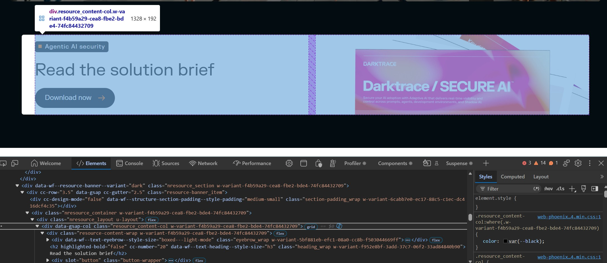
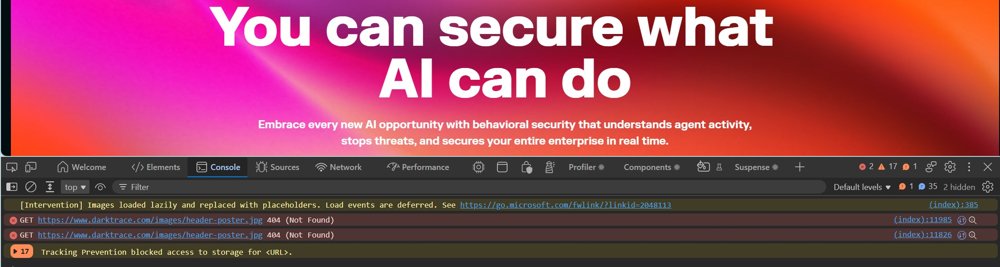
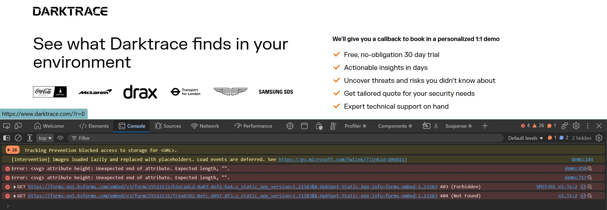
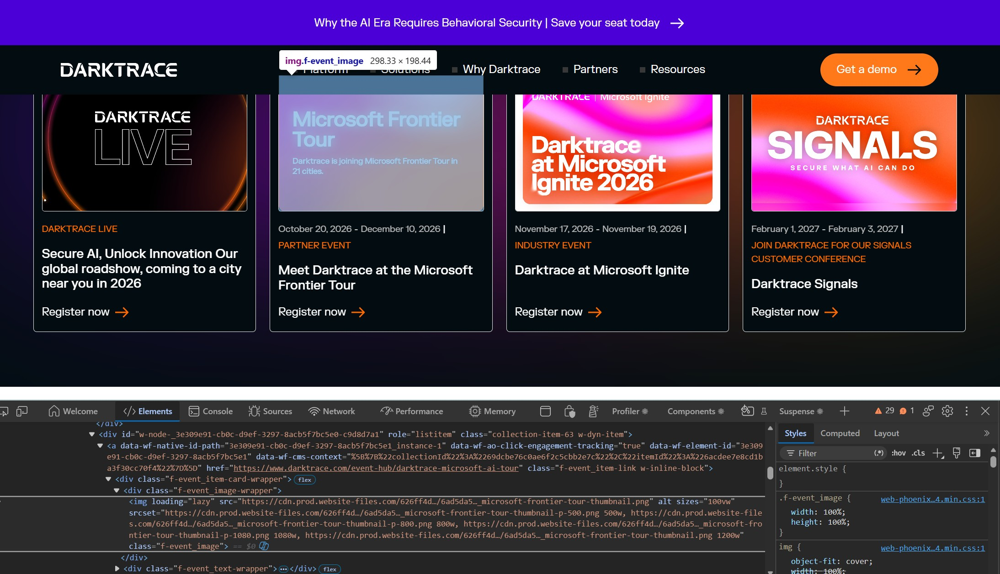

# Playwright Testing for Darktrace's Website

This Playwright automation test framework uses TypeScript to automate [Darktrace](https://www.darktrace.com/)

## Aim/Goals
- Develop Playwright automation framework using TypeScript.
- Demonstrate use of POM (Page Object Model) to show readable, maintainable and scalable code.
- Initialise setup tests to run first, confirming environment is ready before running remaining automation tests.
- Create UI tests to verify core webpages are present and functional.
- Create API tests to verify status (alternative smoke testing).
- Perform tests against a variety of web browsers and mobile viewports.
- Integrate CI/CD workflow using GitHub Actions.
- Development timeboxed to 1-2 days.
- Raise areas of website improvements.


## Setup Instructions

Steps on how to install dependencies and execute the tests.

1. Ensure the following are installed:
   - [Node.js](https://nodejs.org/) (v18 or higher)
   - [npm](https://www.npmjs.com/)
   - [Git](https://git-scm.com/)

2. Clone this [repository](https://github.com/pendragon888/DarktraceWebsite/) into your local machine using the terminal (Mac), CMD (Windows), or a GUI tool like SourceTree.

3. Install the node dependencies:

    ```bash
    npm install
    npm install dotenv
    ```

4. To install the playwright browsers:

    ```bash
    npx playwright install
    ```

5. To run all the tests in the directory:

    ```bash
    npx playwright test
    ```


    or to see tests in UI mode
    ```bash
    npx playwright test --ui
    ```

6. To run tests from a specific spec file:

    ```bash
    npx playwright test landing.spec.ts
    ```


## Areas of Interest / Suggested Improvements

### data-testid

- Adding the 'data-testid' HTML attribute to uniquely identified elements in the UI would contribute towards the reliability, maintainance, stability and scalability of the automated tests.




### Missing assets / 404 Not Found error

- On the landing page as well some others (i.e. ) the console is throwing errors. These either need to be added or the references removed if no longer needed.




### 403 Forbidden error

- There is a 403 Forbidden error shoing on the 'Get a demo' page (https://www.darktrace.com/demo)




### Missing alt-text from images
- Many alt-text descriptions to images are missing such as on the Darktrace webpage. Adding this would help towards accessibility compliance.




## Testing Framework Developed By

**Kevin D**

QA Automation Engineer
